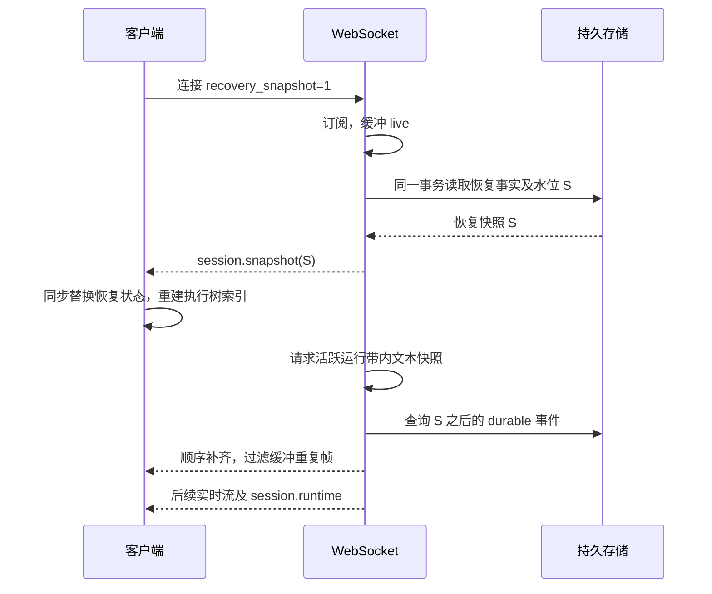

# 会话恢复契约

当前 SDK 的首次连接、切换会话和断线重连均请求 `recovery_snapshot=1`。服务端先建立实时订阅，再发送 `session.snapshot`，客户端在一个同步应用步骤里恢复消息、运行状态、交互和执行树，随后消费新事件。

## 快照内容与读取边界

`SessionRuntimeService.getRecoverySnapshot` 读取以下事实并完成纯投影：

- `messages`：根线程最近 100 条可见消息及分页边界；使用与历史接口相同的执行入口判断，不输出 `provider_state`。
- `runtime`：当前活动运行、最近终态运行、待处理交互、维护状态和可执行动作。
- `participants`：根参与者、子参与者及其最新运行状态。
- `pending_requests`：待确认或排队的用户请求回执，用于恢复补充消息状态。
- `execution`：活动根运行按用户消息边界划分的原生执行树，包含子运行；`tree` 是 SDK 使用的整棵活动执行树。客户端一次建立索引，后续工具结果继续增量更新。
- `event_watermark`：与上述事实同时读取的持久事件水位 S。

Local 在同一个同步 SQLite 事务内完成读取；SaaS 使用同一个 PostgreSQL `REPEATABLE READ READ ONLY` 事务，禁止恢复读取夹带数据修补或行锁。参与者最新运行与活动运行树查询不受历史运行分页上限截断。

快照按需生成，当前没有新增持久快照表。完成运行通过持久消息和终态事实恢复；活动执行树由服务端从该树的 durable 事件投影生成，浏览器无需重放旧运行帧。历史执行细节仍按需从消息记录读取。

## 快照与实时流交接

每次全量快照可以重建游标基线，包括备份恢复后服务端水位低于旧客户端水位的情况。普通事件仍按 `seq` 去重。心跳不推进客户端游标；服务端在心跳时主动查询并补齐持久事件，因此缺少实时通知也能收敛。新契约逐行检查 S 后的连续序号，补齐失败、窗口为空或部分缺失时关闭连接，下一次握手重新取得快照。

流式 delta 继续走 ephemeral 通道，轮末全文、工具和生命周期事件保持 durable。增量帧标记所属轮次，已经被 durable 全文检查点封口的轮次拒绝迟到增量与过期局部快照，避免产生重复文本或幻影新轮。当前在飞文本使用已有的运行串行 journal 带内全文快照覆盖；运行不在本实例执行或取像失败时，恢复精度暂时退回最后一个 durable 检查点，下一次全文检查点继续收敛。此处没有承诺跨实例恢复每一个未持久化 token。

`event_watermark` 是事件边界，不是所有状态变更的通用版本号。普通 runtime 刷新串行发送，SDK 和前端拒绝较低水位的 runtime；连接代次阻止旧 socket 继续投递。相同水位的维护到期等状态更新仍允许应用。

## 前端与 SSE

聊天路由入口不再依次拉取 HTTP 历史、参与者再建立事件连接；这些恢复事实由首帧快照提供。会话配置、文件和历史执行详情仍使用各自查询接口。

快照使已在途的历史 HTTP 请求及消息身份合并失效。普通 HTTP 权威重载还会检查消息投影是否在请求期间变化，避免迟到响应覆盖新的实时内容；运行态和上下文统计等控制帧不会单独废弃消息重载。已有子线程缓存失效，并重新读取已加载线程；保留期间新到的实时执行投影。快照接管时清理旧交互界面，再展示快照里的有效交互。上下文统计在恢复后独立加载。视图拥有的事件游标 Map 有数量上限，并在卸载时清空。

SSE 中断只代表传输中断，SDK 不再生成失败的 `run_ended`，也不据此把运行改为 idle。SDK 重新建立 WebSocket 快照握手，由快照确认运行仍在进行、等待交互或已经结束。WebSocket 接管时废弃旧 SSE 投影回调及用户交互副本，不请求取消服务端任务。已经执行中的宿主工具仍通过原 SSE resume 契约回传结果，正在提交的结果流可以完成，但不能修改 WebSocket 接管后的运行状态。

## 日志保留与兼容

水位优先读取现有 `session_event_seq`，并兼容存量 outbox 的较高序号；显式序号写入同步推进计数器。分配新序号时也从现有日志归一缺失或偏低的计数器，避免半迁移或手工恢复造成序号回退。

已投递事件按既有时间窗口清理；活动或 suspended 运行及其已完成后代的执行事件保持到整棵运行树结束。已完成运行恢复不依赖这个重放窗口，也不会把已清理日志导致的低 MAX 当成真实水位。

不带 `recovery_snapshot=1` 的旧客户端继续使用已有 runtime/replay 握手。当前 SDK 默认请求新契约；外部消费原始事件的调用者需要处理 `session.snapshot`，或使用 SDK 的 runtime、executionTree 可观察值。混合部署需先升级服务端再升级客户端。

快照读取不修补历史请求回执。存量排队消息的回执补建及超时 processing 状态修复仍由前端连接后的请求状态查询完成；仅消费原始快照的 SDK 调用者若需要这部分历史兼容结果，应继续查询请求状态接口。

## 回归验证

- WebSocket 路由握手：订阅早于快照、只发送 S 后事件、缓冲期间新增事件、丢通知心跳补齐、窗口全部或部分缺失重新取像。
- Local 存储：活动执行树与交互、已完成后代、终态运行日志清理后恢复、历史计数器归一。
- SaaS 存储：同一个只读 Repeatable Read 事务，无恢复修补写入或行锁。
- 协议与 SDK：心跳不吞事件、较低快照基线、原生树索引增量续接、SSE 中断后快照接管、宿主工具结果跨接管回传。
- 前端：快照失效在途 HTTP 及身份合并、迟到历史不会替换新消息、控制帧不吞消息重载、旧 runtime 不能倒灌、交互及上下文统计恢复、游标随视图释放。
